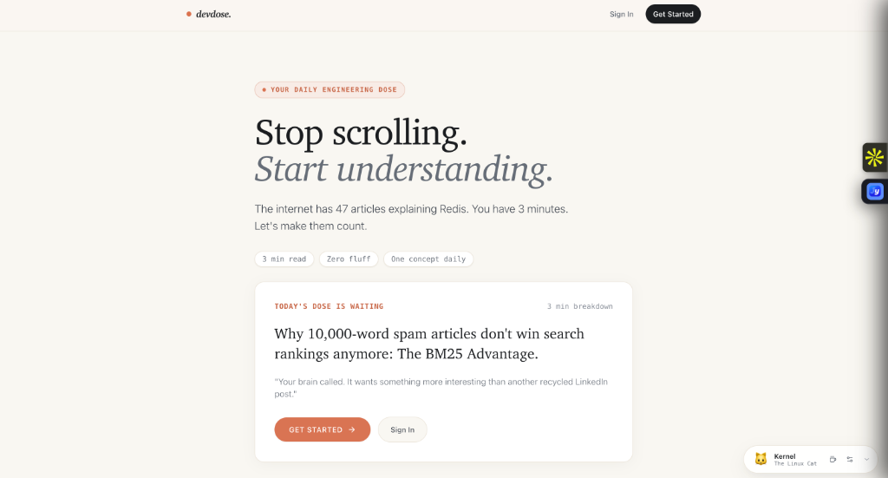
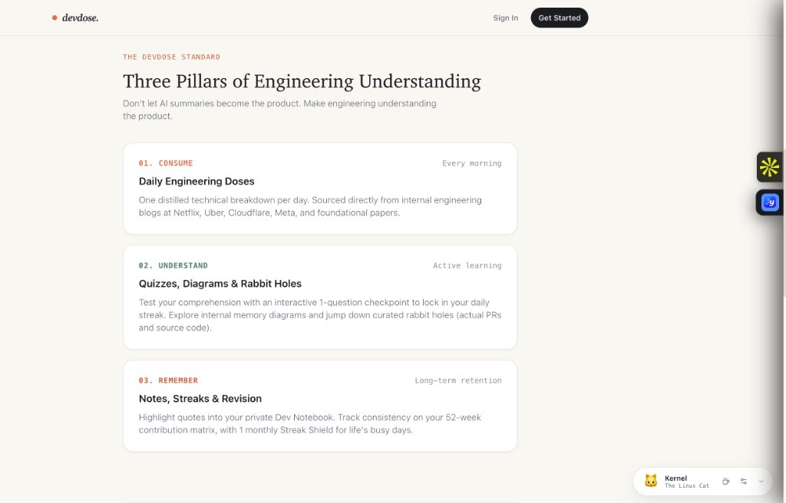
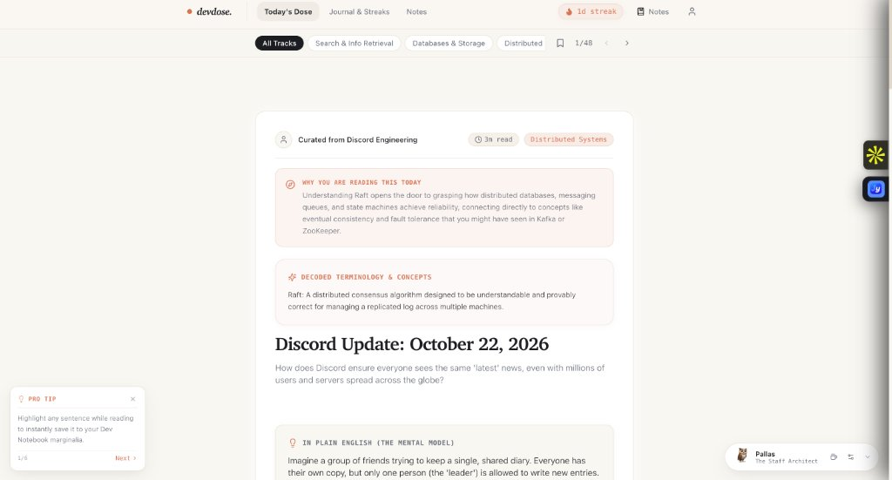
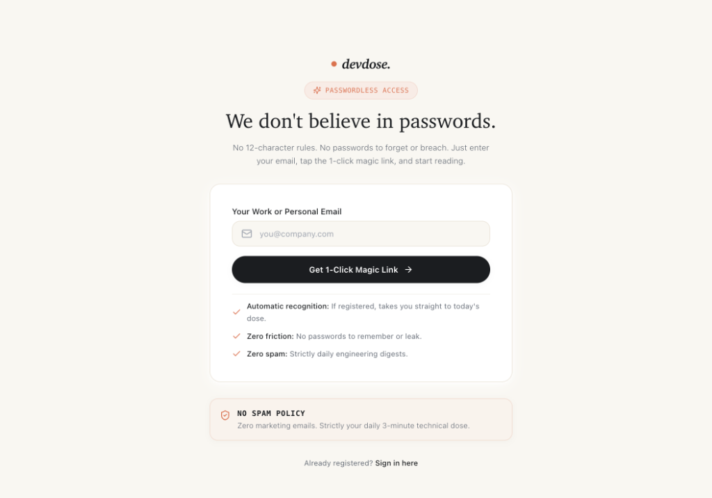
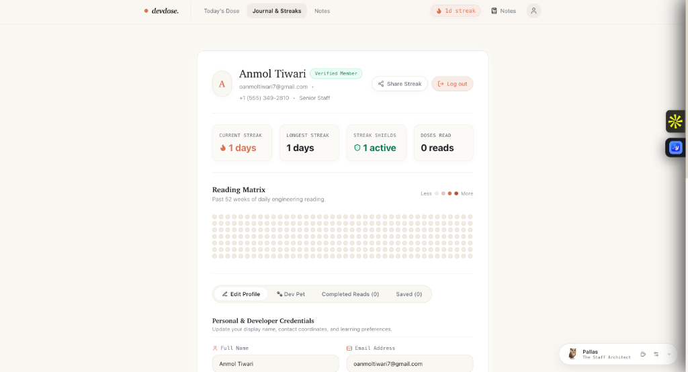

# DevDose ⚡
> **The Daily 3-Minute Architectural Reading Ritual for Software Engineers.**

DevDose turns dense engineering war stories, production post-mortems, distributed systems whitepapers, and high-scale system designs (from Netflix, Uber, Discord, Cloudflare, and Elastic) into **high-retention, 3-minute architectural breakdowns**.

Stop scrolling recycled social media posts. Form a daily learning habit, protect your reading streaks, highlight key marginalia, and internalize senior engineering intuition—all in the time it takes your morning coffee to brew.

---

## 📸 Product Walkthrough

### 1. Stop Scrolling. Start Understanding.
A distraction-free, warm editorial home for daily technical reading. Features everyday doses, estimated reading times, and companion desktop pets.

---

### 2. The Three Pillars of Engineering Understanding
Don't let AI summaries become the product. Make engineering understanding the product.
- **Consume:** One distilled technical breakdown per day from top engineering blogs.
- **Understand:** Test comprehension with 1-question checkpoints, memory diagrams, and deep dives.
- **Remember:** Highlight quotes into your private notebook and track consistency across 52 weeks.

---

### 3. The 3-Minute Architectural Breakdown
Engineered for deep comprehension without fluff:
- **Why You Are Reading This Today:** Direct motivation and real-world context.
- **Decoded Terminology & Concepts:** Jargon eliminated before diving in.
- **In Plain English (The Mental Model):** Real-world analogies for complex systems (e.g., how Raft consensus is like a shared diary among friends).
- **Pro Tip Micro-learning:** Senior architectural marginalia tucked neatly alongside your reading.

---

### 4. 1-Click Passwordless Access
We don't believe in passwords. No 12-character rules, no credentials to breach, and zero friction. Enter your email, tap the magic link, and start reading immediately.

---

### 5. Reading Matrix, Streaks & Habit Math
Track your technical growth with a LeetCode/GitHub-style 52-week contribution heatmap, streak freeze shields for busy on-call days, and verified member credentials.

---

## ✨ Core Product Features

### 📖 High-Yield Architectural Doses
- **The Mental Model:** Intuitive analogies explaining complex machinery like LSM-trees, Raft, or BM25 search ranking.
- **What Stuff It Actually Considers:** Structured factor boxes breaking down internal metrics, heuristics, and algorithmic weights.
- **Acronyms Decoded:** Inline decoding pill that automatically expands technical acronyms into crystal-clear definitions.
- **Production War Stories:** Real architecture trade-offs from engineering teams operating at global scale.

### 🔥 Habit Math & Streaks
- **52-Week Matrix:** Visual representation of your daily learning ritual.
- **Comprehension Streak Lock:** Answer a 1-question daily concept checkpoint to lock in your daily streak.
- **Compounding Habit Math:** 3 minutes a day compounds to **~18 hours of senior architectural reading** over the course of a year.

### 🛡️ Streak Freeze Shields
- Life happens. Every reader receives a monthly **Streak Shield** that automatically activates if a production fire pulls you away for the day.

### 📝 Marginalia & Dev Notebook
- Highlight any sentence or code snippet while reading.
- Instantly save quotes, insights, and marginalia into your private **Dev Notebook**.

### 🎯 7 High-Yield Engineering Tracks
1. **Distributed Systems:** Consensus (Raft), Event Streaming (Kafka), Split-Brain, CAP theorem.
2. **Databases & Storage:** LSM-Trees, Write-Ahead Logs (WAL), B-Trees, MVCC.
3. **Caching Strategies:** Cache Stampede Prevention, Probabilistic Early Expiration (XFetch).
4. **Search & Information Retrieval:** BM25, TF-IDF, Vector Embeddings & Hybrid Search.
5. **Algorithms & Optimization:** Bloom Filters, Consistent Hashing, Rate Limiting (Token Bucket).
6. **Networking & Reliability:** Circuit Breakers, Exponential Backoff with Jitter, eBPF.
7. **Production War Stories:** Real-world failures, incident post-mortems, and scaling rewrites.

### 🐾 Companion Desktop Pets
Interactive animated companions (like *Kernel the Linux Cat* and *Pallas the Staff Architect*) that accompany your daily reading sessions.

---

## 🎨 Design Philosophy

DevDose rejects generic dark-mode dashboards in favor of a **warm editorial paper & terracotta aesthetic**:
- **Typography:** Warm serif headlines (`Newsreader`) paired with clean sans body text (`Inter`) and technical mono labels (`JetBrains Mono`).
- **Color Palette:** Soft warm cream paper backgrounds (`#FAF7F2`), deep charcoal ink (`#1E1C1A`), and muted terracotta clay accents (`#E06D53`).
- **Tactile UI:** Subtle border contrasts, fluid Framer Motion transitions, and editorial breathing room.

---

## 🚀 Live Product

Experience DevDose live in production:

👉 **[https://devdosee.vercel.app](https://devdosee.vercel.app)**

---

## 👨‍💻 Created By

Crafted with ❤️ by **[Bilkulanmol](https://bilkulanmol.vercel.app/)**  
*Portfolio & Work:* [https://bilkulanmol.vercel.app/](https://bilkulanmol.vercel.app/)
